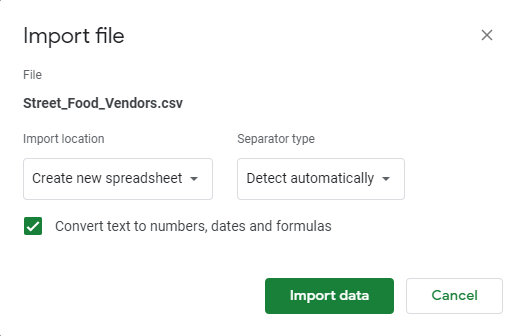

**Date**: Nov. 5, 2026<br>
**Course Code & Course Name**: MPAD 2003 - Introductory Data Storytelling<br>
**Student's First Name & Last Name**: Zahira Bakr<br>
**Presented to Jean-Sébastien Marier**<br>

# Deliverable 2: Exploratory Data Analysis (EDA)

Use one hashtag symbol (`#`) to create a level 1 heading like this one.

## Foreword

For this assignment, you must clean and analyze the dataset from Deliverable 1, create exploratory charts/visualizations, and identify a potential story. Your assignment must clearly detail your process. You are expected to write about 1,000-1,200 words, and to include several screen captures showing the different steps you went through. Your assignment must be written with the Markdown format and submitted on GitHub.

I have been assigning different versions of this project to my digital journalism and data storytelling students for a few years now. Its structure was inspired by the main sections/chapters of [*The Data Journalism Handbook*](https://datajournalism.com/read/handbook/one/). This version was further inspired by the [Key Capabilities in Data Science](https://extendedlearning.ubc.ca/programs/key-capabilities-data-science) program offered by the University of British Columbia (UBC).

**Here are some useful resources for this assignment:**

* [GitHub's *Basic writing and formatting syntax* page](https://docs.github.com/en/get-started/writing-on-github/getting-started-with-writing-and-formatting-on-github/basic-writing-and-formatting-syntax)
* [The template repository for this assignment in case you delete something by mistake](https://github.com/jsmarier/jou4100_jou4500_mpad2003_project2_template)

Did you notice how to create a hyperlink? In Markdown, we put the clickable text between square brackets and the actual URL between parentheses.

And to create an unordered list, we simply put a star (`*`) before each item.

## 1. Getting Data

Use two hashtag symbols (`##`) to create a level 2 heading like this one.

To include a screen capture, use the sample code below. Your images should be saved in the same folder as your `.md` file.

<br>
*Figure 1: The "Import file" prompt on Google Sheets.*

**Here are examples of functions and lines of code put in grey boxes:**

1. If you name a function, put it between "angled" quotation marks like this: `IMPORTHTML`.
1. If you want to include the entire line of code, do the same thing, albeit with your entire code: `=IMPORTHTML("https://en.wikipedia.org/wiki/China"; "table", 5)`.
1. Alternatively, you can put your code in an independent box using the template below:

``` r
=IMPORTHTML("https://en.wikipedia.org/wiki/China"; "table", 5)
```
This also shows how to create an ordered list. Simply put `1.` before each item.

All data was sourced from the Ottawa Neighbourhood Study (ONS-SQO). To gather the data from their [website](https://ons-sqo.ca/maps/), the chart visualization for a given dataset was selected. HTML sources were downloaded from the page, and the data table manually selected. This is because the data takes the form of an interactive visualization with options between map and chart views, and as such Google Sheets was not able to import the embedded HTML table. 
Once the HTML table was isolated it was compiled on a dedicated web page found at [this page](https://oughegr.neocities.org/), to then be imported using Sheets' `=IMPORTHTML("https://oughegr.neocities.org/", "table", n)`, where `n` was 1-23.

The resulting data can be found [here](https://docs.google.com/spreadsheets/d/1LsJBjsZ38paX0MrHKggheRsNlp18-JJRSkHBtGmfKiQ/edit?usp=sharing).

## 2. Understanding Data

### 2.1. VIMO Analysis

Use three hashtag symbols (`###`) to create a level 3 heading like this one. Please follow this template when it comes to level 1 and level 2 headings. However, you can use level 3 headings as you see fit.

Insert text here.

Support your claims by citing relevant sources. Please follow [APA guidelines for in-text citations](https://apastyle.apa.org/style-grammar-guidelines/citations).

**For example:**

As seen in Bounegru & Gray (2011), a data visualization should be clear...

### 2.2. Cleaning Data

Several neighbourhoods were excluded due to an absence of data - the original datasets exclude several, such as Carleton University and Beechwood Cemetary, due to not having reliable data in those communities. At this point, the list of communities are:

Alta Vista

Bayshore

Beacon Hill South - Cardinal Heights

Beaverbrook

Bells Corners East

Bells Corners West

Billings Bridge - Heron Park

Blackburn Hamlet

Blossom Park - Timbermill

Borden Farm - Fisher Glen

Braemar Park - Bel Air Heights - Copeland Park

Bridlewood - Emerald Meadows

Britannia

Brookside - Briarbrook - Morgan's Grant

Cardinal Creek

Carleton Heights - Courtland Park

Carlington

Carp

Carson Grove - Carson Meadows

Centrepointe

Centretown

Chapel Hill North

Chapel Hill South

Chapman Mills

City view

Civic Hospital

Constance Bay

Convent Glen - Orléans Woods

Corkery

Craig Henry - Manordale

Crestview - Tanglewood

Crystal Bay - Lakeview Park

Cumberland

Dunrobin

Edwards - Carlsbad Springs

Elmvale - Canterbury

Emerald Woods - Sawmill Creek

Fallingbrook

Findlay Creek

Fisher Heights

Fitzroy

Glebe - Dows Lake

Glen Cairn

Greely

Greenboro East

Greenboro West

Hawthorne Meadows - Sheffield Glen

Hintonburg - Mechanicsville

Hunt Club Park

Iris

Island Park - Wellington Village

Kanata Lakes

Katimavik - Hazeldean

Kinburn

Laurentian

Ledbury - Heron Gate - Ridgemont

Leslie Park - Bruce Farm

Lowertown East

Lowertown West

Manor Park

Manotick

Marlborough

Merivale Gardens - Grenfell Glen - Pineglen - Country Place

Metcalfe

Munster - Ashton

Navan - Sarsfield

New Edinburgh

North Gower - Kars

Old Barrhaven East

Old Barrhaven West

Old Hunt Club

Old Ottawa East

Old Ottawa South

Orléans Village - Chateauneuf

Osgoode - Vernon

Overbrook

Parkwood Hills

Pineview

Playfair Park - Guildwood Estates

Portobello South

Qualicum - Redwood

Queensway Terrace North

Queenswood - Chatelaine

Queenswood Heights

Richmond

Rideau Crest - Davidson Heights

Riverside Park - Mooney's Bay

Riverside Park South - Revelstoke

Riverside South - Leitrim

Riverview

Rockcliffe Park

Rothwell Heights - Beacon Hill North

Sandy Hill

South Keys

Stittsville

Stittsville East

Stittsville North

Stonebridge - Half Moon Bay

Trend-Arlington

Vanier North

Vanier South

Vars

Wateridge Village

West Centretown

Westboro

Whitehaven - Woodpark - Glabar Park

### 2.3. Analyzing Data

Insert text here.

**This section should include a screen capture of your pivot table, like so:**

<br>
*Figure 2: This pivot table shows...*

**This section should also include a screen capture of your exploratory chart, like so:**

<br>
*Figure 3: This exploratory chart shows...*

## 3. Delivering Data

Insert text here.

## 4. References

Include a list of your references here. Please follow [APA](https://apastyle.apa.org/style-grammar-guidelines/references) or [MLA](https://www.mla.org/MLA-Style) guidelines for references. Hanging paragraphs aren't required though.

**Here's an example:**

Bounegru, L., & Gray, J. (Eds.). (2021). *The Data Journalism Handbook 2: Towards A Critical Data Practice*. Amsterdam University Press. [https://ocul-crl.primo.exlibrisgroup.com/permalink/01OCUL_CRL/hgdufh/alma991022890087305153](https://ocul-crl.primo.exlibrisgroup.com/permalink/01OCUL_CRL/hgdufh/alma991022890087305153)
